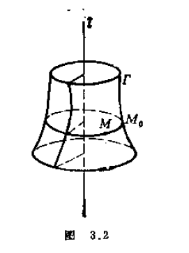
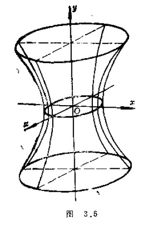
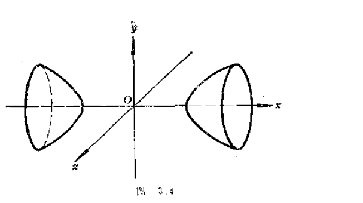
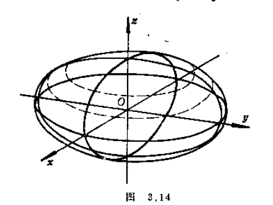

# 旋转面与椭球面

4. 旋转面
**定义**:平面曲线绕同一平面的直线旋转一周得到的图形.
该曲线称为**子午线**,直线称为**轴线**.

子午线 $P$:

$$
\begin{cases}
f(y,z)=0, \\
x=0.
\end{cases}
$$

设旋转面为 $S$,方程为 $F(x,y,z)=0$.
$\forall$ 点 $P(x_0,y_0,z_0)\in S$,过点 $P$ 作一平面 $\pi$ 与 $z$ 轴垂直,该平面方程为

$$
z=z_0.
$$

$\pi$ 与子午线 $P$ 交于点 $P'(0,y_1,z_0)$.又 $P$ 与 $P'$ 到 $z$ 轴距离相同,因此

$$
x_0^2+y_0^2=y_1^2 \Longrightarrow y_1=\pm\sqrt{x_0^2+y_0^2}.
$$

而 $P'\in P$,于是

$$
f\left(\pm\sqrt{x_0^2+y_0^2},\ z_0\right)=0.
$$

即 $S$ 的方程为

$$
f\left(\pm\sqrt{x^2+y^2},\ z\right)=0.
$$

例 1

$$
P:\begin{cases}\dfrac{y^2}{a^2}-\dfrac{z^2}{b^2}=1,\\[8pt] x=0.\end{cases}
$$

1. $P$ 绕 $z$ 轴旋转,得到旋转面方程为

$$
\frac{x^2+y^2}{a^2}-\frac{z^2}{b^2}=1
$$

单叶旋转双曲面.

2. $P$ 绕 $y$ 轴旋转一周,得到旋转面方程为

$$
\frac{y^2}{a^2}-\frac{x^2+z^2}{b^2}=1
$$

双叶旋转双曲面.

例 2:异面直线 $l_1$,$l_2$
$z$ 轴为 $l_1$,$x$ 轴为公垂线.$l_2$ 与 $x$ 轴交于点 $P(a,0,0)$.
$l_2$ 的方向为 $\vec v=(0,1,c)$,即

$$
l_2:\begin{cases}x=a+0t, \\ y=0+1t, \\ z=0+ct.\end{cases}
$$

设旋转后的图形为 $S$,$\forall$ 点 $Q(x,y,z)$,过点 $Q$ 作平面 $\pi$,它与 $l_2$ 交于点

$$
Q'\left(a,\ \frac{z}{c},\ z\right).
$$

又 $Q$ 与 $Q'$ 到 $z$ 轴距离相等,故

$$
x^2+y^2=a^2+\frac{z^2}{c^2}
\quad\Longleftrightarrow\quad
\frac{x^2+y^2}{a^2}-\frac{z^2}{a^2c^2}=1.
$$

例 3:Möbius 带

$$
\begin{cases}
x=\left(R-r\sin\dfrac{\theta}{2}\right)\cos\theta,\\[8pt]
y=\left(R-r\sin\dfrac{\theta}{2}\right)\sin\theta,\\[8pt]
z=r\cos\dfrac{\theta}{2},
\end{cases}
\qquad
0\leq\theta\leq2\pi,\qquad -1\leq r\leq1.
$$

两种方法
① **伸缩法** ② **截痕法**
若曲面 $S$ 的方程为 $F(x,y,z)=0$,将曲面分别沿 $x$ 轴,$y$ 轴和 $z$ 轴拉长 $a,b,c$ 倍,得到 $S'$,此时 $S'$ 的方程为

$$
F\left(\frac{x}{a},\ \frac{y}{b},\ \frac{z}{c}\right)=0.
$$

**原因**:$\forall P(x,y,z)\in S'$,将 $P$ 点沿 $x$ 轴,$y$ 轴,$z$ 轴压缩 $a,b,c$ 倍,得到点

$$
P'\left(\frac{x}{a},\frac{y}{b},\frac{z}{c}\right),
$$

此时 $P'\in S$,故

$$
F\left(\frac{x}{a},\frac{y}{b},\frac{z}{c}\right)=0.
$$

§1 椭球面

$$
\frac{x^2}{a^2}+\frac{y^2}{b^2}+\frac{z^2}{c^2}=1
\qquad (*)
$$

将球面

$$
x^2+y^2+z^2=1
$$

分别沿 $x$ 轴,$y$ 轴和 $z$ 轴拉长 $a,b,c$ 倍.

用平面 $z=h$ 去截 $(*)$,得到平面图形

$$
\begin{cases}
\dfrac{x^2}{a^2}+\dfrac{y^2}{b^2}=1-\dfrac{h^2}{c^2},\\[8pt]
z=h,
\end{cases}
$$

是椭圆.椭圆的顶点为

$$
\left(\pm a\sqrt{1-\frac{h^2}{c^2}},\ 0,\ h\right)
$$

及

$$
\left(0,\ \pm b\sqrt{1-\frac{h^2}{c^2}},\ h\right).
$$

当 $h$ 变动时,顶点的轨迹分别是

$$
\begin{cases}
\dfrac{x^2}{a^2}+\dfrac{z^2}{c^2}=1,\\[8pt]
y=0,
\end{cases}
\qquad
\begin{cases}
\dfrac{y^2}{b^2}+\dfrac{z^2}{c^2}=1,\\[8pt]
x=0.
\end{cases}
$$

它们是一对正交的,有一对公共的轴的椭圆.
椭球面可以看作是椭圆上下移动得到,在移动中保证顶点分别在上述椭圆对上,且与它们公共的轴线垂直.

